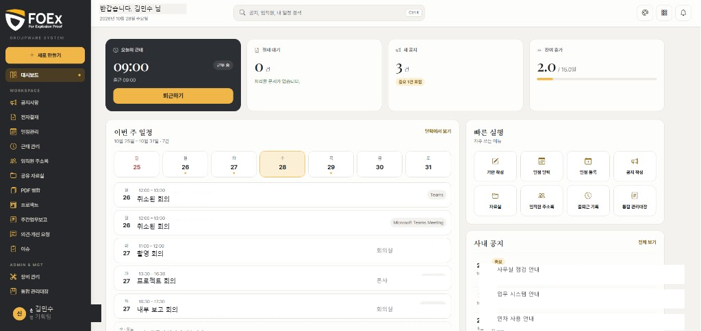
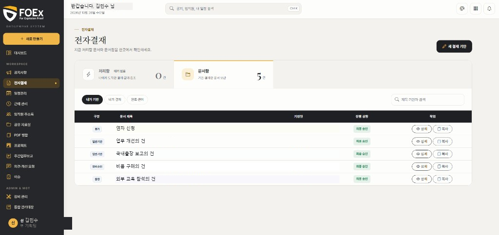
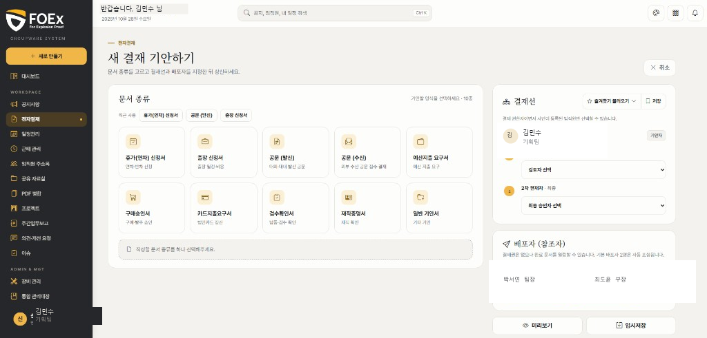
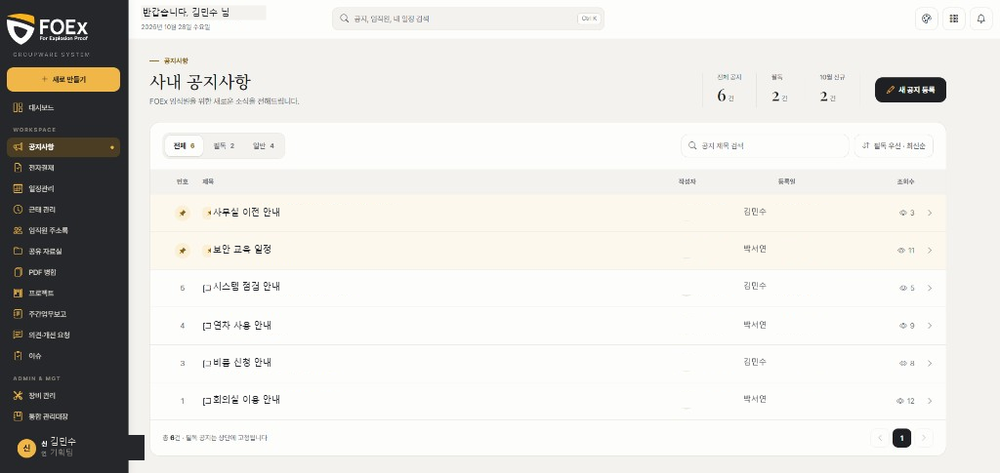
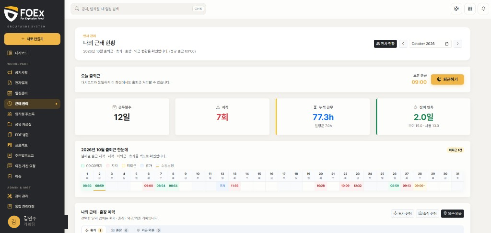
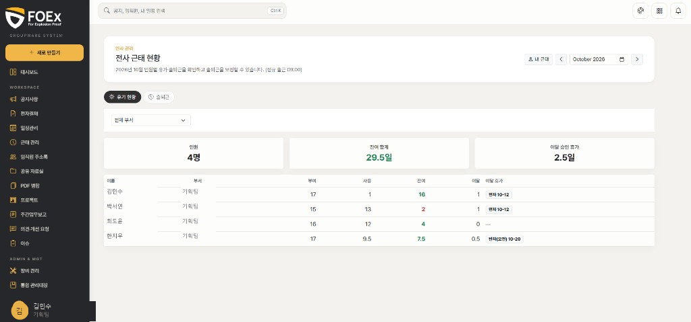
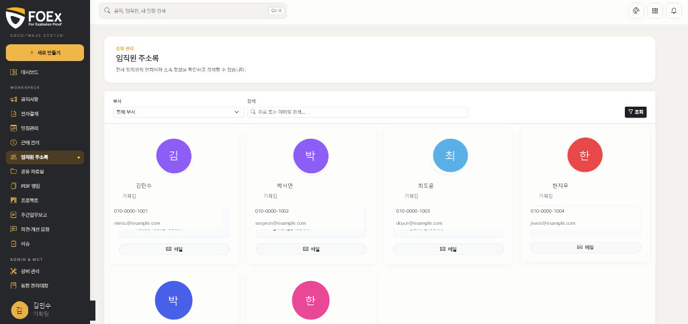

# FOEx 그룹웨어

사내 업무를 한 화면에서 처리하도록 다시 만든 그룹웨어입니다. 2026년 7월부터 10월까지 진행했고, 2026년 9월 1일에 사내 오픈한 뒤 화면과 업무 기능을 이어서 다듬었습니다.

결재, 공지, 일정, 근태, 장비, 주간보고를 한 제품으로 두고, 문서와 파일의 정본은 그룹웨어가 갖습니다. 로그인은 Microsoft 계정입니다. 사내 시스템이므로 주소는 공개하지 않습니다.

## 무엇을 바꿨나

기존에는 결재와 문서, 예산, 장비가 서로 다른 흐름에 나뉘어 있었습니다. 이번 작업은 기안부터 승인, PDF 보관, 예산 반영까지 그룹웨어 안에서 이어지게 했습니다. 10월에는 대시보드, 공지, 전자결재, 기안 화면을 시안 기준으로 정리했습니다.

| 구분 | 내용 |
|------|------|
| 결재 | 처리함·문서함, 기안 10종, 결재선, 임시저장, PDF 미리보기·보관 |
| 문서 | 공문 발신·수신, 문서번호와 파일명 규칙 |
| 돈 | 프로젝트 예산 원장. 승인 전에는 잡아 두고, 최종 승인 때 반영 |
| 현장 | 장비 대장, 변경 승인, 근태, 주간업무보고 |
| 화면 | 사이드바·상단 정리, 테마 6종. 기본은 크림 |

디자인 원본은 디자이너 시안입니다. 화면 구현, 결재·PDF·예산·장비 흐름, 운영 반영을 맡았습니다.

## 메뉴

사내 로그인 뒤의 화면입니다. 주소는 적지 않습니다.

| 메뉴 | 하는 일 |
|------|---------|
| 대시보드 | 오늘 근태, 이번 주 일정, 처리할 결재, 공지 |
| 공지사항 | 목록, 필독 고정, 작성 |
| 전자결재 | 처리함, 문서함, 새 결재 기안 |
| 일정관리 | 달력, Microsoft 일정 동기화 |
| 근태 관리 | 출퇴근, 월간 기록 |
| 임직원 주소록 | 사원 목록 |
| 공유 자료실 | 파일 올리기·받기 |
| PDF 병합 | PDF 여러 장을 하나로 |
| 프로젝트 | 프로젝트와 예산 비목 |
| 주간업무보고 | 주차별 작성·제출 |
| 장비 관리 | 자산 대장, 변경 요청과 승인 |
| 통합 관리대장 | 결재가 끝난 문서의 대장 |
| 사원 통합 관리 | 권한 관리 |

기안 양식은 10종입니다. 휴가, 출장, 공문 발신, 공문 수신, 예산지출, 구매승인, 카드지출, 검수확인, 재직증명, 일반기안. 출장은 신청과 보고가 나뉘고, 장비 변경은 장비 화면에서 승인을 탑니다.

## 화면

1920px 폭으로 찍은 화면을 `images` 폴더에 아래 이름으로 넣으면 이 글에 바로 붙습니다. 이름, 금액, 문서번호, 사내 주소는 가리거나 샘플 데이터로 찍어 주세요.

| 파일 | 화면 |
|------|------|
| `images/01-dashboard.png` | 대시보드 |
| `images/02-approvals.png` | 전자결재 |
| `images/03-draft.png` | 새 결재 기안 |
| `images/04-notices.png` | 공지사항 |
| `images/05-attendance.png` | 근태 관리 |
| `images/06-team-attendance.png` | 전사 근태 |
| `images/07-directory.png` | 임직원 주소록 |

### 대시보드

### 전자결재

### 새 결재 기안

### 공지사항

### 근태 관리

### 전사 근태

### 임직원 주소록

## 구성을 나눈 방식

화면과 문서 정본을 같은 자리에 두지 않았습니다.

* **시안이 있는 화면**은 Vue로 맞췄습니다. 대시보드, 공지 목록과 작성, 전자결재 목록, 새 기안이 여기 해당합니다. 버튼 문구와 동작은 실제 업무 기준으로 두었고, 시안의 비활성 버튼은 그대로 가져오지 않았습니다.
* **문서와 돈**은 Laravel과 데이터베이스가 갖습니다. 기안, 결재 상태, PDF, 예산 차감, 장비 대장이 여기 해당합니다. 승인 결과가 두 번 반영되지 않도록 처리했습니다.
* **자주 바뀌는 내용**은 화면에서 고칩니다. 공지, 일정, 자료실, 장비, 주간보고가 여기 해당합니다.

결재선은 기안 화면에서 지정합니다. 미리보기와 보관 PDF는 같은 양식을 씁니다. 증빙으로 올린 PDF는 페이지 이미지로 바꿔 양식 뒤에 붙입니다.

## 화면 테마

기본 테마는 크림입니다. 그 밖에 포그, 세이지, 라일락, 더스크, 잉크가 있습니다. 바탕색을 테마마다 바꾸고, 아이콘과 버튼은 그 바탕에서 구분되는 색을 씁니다. 로고 형태는 그대로 두고, 글자와 방패 안의 빈 공간은 사이드바 색이 비치게 했습니다. 선택한 테마는 브라우저에 남습니다.

## 기술

| 계층 | 사용 |
|------|------|
| 언어·런타임 | PHP 8.2 |
| 프레임워크 | Laravel 12 |
| 화면 | Vue 3, Inertia, Vite |
| 데이터 | MariaDB, Redis |
| PDF | Gotenberg, DomPDF 폴백 |
| 로그인 | Microsoft Entra ID |
| 실시간 | Laravel Reverb |
| 운영 | Docker Compose |
| 검사 | PHPUnit, PHPStan, GitHub Actions |

근태는 퇴근을 직접 누르면 그 시각을 남깁니다. 누르지 않은 날은 다음 날 출근할 때, 또는 다음 날 오전 9시 자동 처리로 전날 18시에 마감합니다.

## 이 저장소에 없는 것

이 저장소는 결과와 구성을 보여 주는 포트폴리오입니다. 운영 중인 애플리케이션 소스, 환경 값, 사원 데이터는 올리지 않았습니다. 화면은 위 파일 이름의 사진으로만 확인합니다.
